# Terrygotchi — Code Architecture & UML

The UML model and code-shape blueprint for implementing `Design.md` in S&Box.

> **Read `Design.md` first** — it is the spec. This document does not restate the
> rules; it decides *where each rule lives in code* and *how the pieces talk*.
> Every class below traces back to a `Design.md` section via the table in §8.
>
> Snapshot: branch `WhatIfAI`. This blueprint is now **fully implemented** in `Code/`
> (all nine §10 milestones). For current build state, in-editor verification, and the
> handful of deviations from this document, read `IMPLEMENTATION_STATUS.md`. The doc
> below is the design-of-record — keep it in sync when the code's structure changes.

---

## 0. Contents

1. [Three load-bearing principles](#1-three-load-bearing-principles) — read these before any code
2. [Layer / package overview](#2-layer--package-overview)
3. [Composition rules](#3-composition-rules-component-vs-plain-class-vs-dto)
4. [Class diagrams by layer](#4-class-diagrams-by-layer)
5. [Enums & state reference](#5-enums--state-reference)
6. [Sequence diagrams](#6-sequence-diagrams-the-dynamic-behaviour)
7. [Persistence: Age and timers across sessions](#7-persistence-age-and-timers-across-sessions)
8. [Traceability: Design.md → classes](#8-traceability-designmd--classes)
9. [Open design questions](#9-open-design-questions-resolve-before-or-during-build)
10. [Suggested build order](#10-suggested-build-order)
11. [Verified engine API touch-points](#11-verified-engine-api-touch-points)

---

## 1. Three load-bearing principles

These three decisions constrain every class. Violate one and the rules in
`Design.md` scatter and rot.

### P1 — Host-authoritative simulation; host-gate the *ticking*, not just the writes

The host (the streamer) runs the **entire** simulation. Clients are thin: they
render synced state and *send* commands. This matches the S&Box networking model
(`NetworkHelper` → `Networking.CreateLobby` → per-connection `NetworkSpawn`).

`Component.OnUpdate`/`OnFixedUpdate` runs on **every machine the GameObject
exists on**. So every timer check and every value mutation must be guarded:

```csharp
protected override void OnFixedUpdate()
{
    if ( !Networking.IsHost ) return;   // clients never tick the sim
    // ... advance timers, mutate state ...
}
```

State that clients need to render is exposed with `[Sync( SyncFlags.FromHost )]`
(host owns the value, replicates down). Clients read it in their *view* code.
Without the host gate, MisbehaveChance RNG diverges per machine and the sim
double-runs.

### P2 — One guarded mutation API on `Terrygotchi` (the value choke point)

Nothing pokes `Hunger`/`Happiness`/`Weight`/`HP` fields directly. All changes go
through `Terrygotchi` methods that take a **source**, because too many rules
layer onto a value change:

- **Min clamp:** no value below −1 (`Design.md` Minimum Values).
- **Misbehaving tax:** while `Misbehaving`, *any* Happiness *gain* is reduced by 1
  extra (Misbehave Timer).
- **Illness caps are source-dependent:** natural recovery (sleep wake-up bonus,
  Recover-Check) must **not** push Happiness past 10 into illness range; but
  Cake/Tickle/Painkiller *can* (the "too much of a good thing" intent).
- **Sausage / Sage pinning:** Sausage stats are static except Age; Sage values are
  pinned (Hunger 0, Happiness 10, Weight 1).
- **Immortality:** HP cannot drop while `Immortal`.
- **Consecutive-illness death:** falling ill twice in quick succession is
  guaranteed death — requires tracking the gap between illness episodes.

The `StatSource` enum (§5) is the discriminator the choke point switches on.

```csharp
// the only legal way to change a primary value:
terry.AddHappiness( +2, StatSource.Item );      // Cake — may exceed 10
terry.AddHappiness( +2, StatSource.SleepBonus ); // capped so it can't cause illness
terry.AddHp( -1, StatSource.Illness );           // ignored while Immortal
```

### P3 — One clock: scene time (offline aging is cut)

- **Scene time** (`Time.Now`, `TimeSince`, `TimeUntil`) drives all ticking. Timers
  reset every session ("No timers persist across sessions").
- **`Age` is the one value that persists** — a plain saved `int` (seconds). On
  load a Terry resumes at its saved Age and keeps counting; there is **no
  wall-clock math**. The "characters age while offline" toggle is **disabled**
  (Design.md, struck through), so there is no `CatchUpSimulator`, no `DateTime`
  catch-up, and no two-clock problem. If ever revived, do it as fixed-step replay
  of the live tick logic — do not derive closed-form deltas.

---

## 2. Layer / package overview

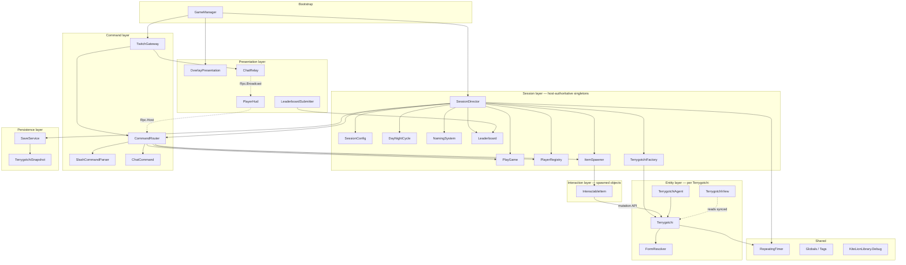

**Dependency direction:** Presentation and Items depend on the Entity/Session
API; the sim never depends on the UI. The host owns Session + Entity + Items +
Persistence. Clients own Presentation. Command flows from both Twitch (host) and
clients (RPC) into one router.

---

## 3. Composition rules (Component vs plain class vs DTO)

Decide what each type *is* by this rule set — it keeps networking and lifecycle
sane.

| Kind | Use when | Examples |
|---|---|---|
| **`Component`** | attached to a GameObject; needs engine lifecycle, `[Property]` editor config, `[Sync]` networking, or `ITriggerListener` | `SessionDirector`, `Terrygotchi`, `TerrygotchiAgent`, `TerrygotchiView`, `InteractableItem` subtypes, `DayNightCycle`, `PlayerHud`, `OverlayPresentation`, `Respawner`, `TwitchComponent` (lib) |
| **Plain C# class** | pure logic / algorithm / in-memory registry, owned by a Component | `CommandRouter`, `SlashCommandParser`, `NamingSystem`, `PlayerRegistry`, `FormResolver`, `Leaderboard`, `RepeatingTimer`, `AverageTracker`, `LifeStageTable` |
| **`record` / DTO** | serializable data or value object | `StageProfile`, `ChatCommand`, `PlayerId`, `FormResult`, `TerrygotchiSnapshot`, `HostSave`, `ClientSave` |
| **Plain class with `[Property]` members** | editor-authored config the inspector must render cleanly (records leak an `EqualityContract` field; see `IMPLEMENTATION_STATUS.md` §0e) | `SessionConfig`, `DifficultyProfile`, `WanderConfig`, `WanderStage`, `RatesConfig`, `StageRates` |
| **`enum`** | closed set | `LifeStage`, `TerryStatus` (Flags), `AdultType`, `SageType`, `CommandVerb`, `StatKind`, `StatSource`, `DayPhase`, item-kind enums |

**A Terrygotchi is one GameObject (prefab) with a small set of Components, not one
per concern.** State lives in a single aggregate root (`Terrygotchi`) so `[Sync]`
isn't fragmented across components. `TerrygotchiAgent` (host movement) and
`TerrygotchiView` (client visuals) are separate only because they have genuinely
different lifecycles and run on different machines.

---

## 4. Class diagrams by layer

### 4.1 Session layer

`SessionDirector` is the simulation root: a networked Component on a scene-root
GameObject. It owns the session timers, the live Terrygotchi set, and the
subsystems. Pure-logic subsystems are plain classes it instantiates; stateful
networked ones (`DayNightCycle`) are sibling Components.

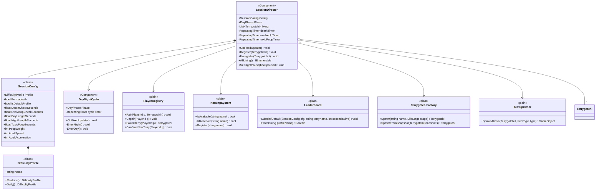

Notes:
- `SessionConfig` is built from a `DifficultyProfile` preset (Realistic/Daily) or
  hand-edited (→ `IsDefaultProfile = false`, no leaderboard contribution). The
  per-field `*Seconds` values are the `X (default Y)` tunables from `Design.md`.
- Realistic (~100,800 s to Adult) and Daily (~14,400 s) are authored directly as separate
  `SessionConfig` values per preset — no runtime multiplier. See Q4 in `IMPLEMENTATION_STATUS.md`
  for the removed-TimeScale history (the per-stage thresholds in `Design.md` are the 1x floor;
  Realistic/Daily bake their own real-second values straight into each preset's fields).
- `Leaderboard` wraps the **platform** service. **Submit with a data payload** so
  the Terry name rides along, only when `Config.IsDefaultProfile`:
  `Stats.SetValue("<profile>_seconds_alive", seconds, new Dictionary<string,object>{ ["terry"] = name })`
  (the dict is JSON-serialized and stored with the stat). **Read via the
  `GetFromStat` path:** `Leaderboards.GetFromStat("<profile>_seconds_alive")` →
  `Board2`, `await board.Refresh()`. Each `Board2.Entry` carries
  `Rank`/`Value`/`SteamId`/`DisplayName`/`Timestamp` plus **`DataUrl`** — fetch
  that URL's JSON to read the submitted Terry name (the inline `Entry.Data` dict is
  `[Obsolete]`, so it's one extra async fetch per row, not a free field).
- **Who contributes — submission is per-machine.** `Stats.SetValue` always submits
  for the **local** SteamId, so credit lands on whichever machine calls it.
  Therefore **each S&Box client submits its own paired Terry**: a client-side
  `LeaderboardSubmitter` (§4.6) reads that Terry's host-synced `Age`/`TerryName`
  and calls `Stats.SetValue` locally, so the entry lands under *that client's*
  Steam account. This is how in-game client players' Terrygotchis contribute to the
  leaderboard under their own names. The **host** submits only Terries that have no
  S&Box-client carer (Twitch-only) — and those can only land under the host's
  account, so optionally disable host-side submission to keep the board to genuine
  per-player entries (decision).
- **Residual constraint:** the board is **SteamId-keyed** — one row per Steam
  account per stat (aggregated, e.g. Max) — so an account shows the best
  seconds-alive among the Terries *it* submitted. Twitch-only viewers have no
  SteamId in the session and can't hold their own entry; S&Box clients (and
  optionally the host) do. The Terry-name display is solved by the data payload
  above. Set `sbproj` `LeaderboardType`/`RankType` accordingly (currently `None`).

### 4.2 Entity layer — the Terrygotchi aggregate

One prefab, one synced aggregate root, plus host-movement and client-view
components. Helper objects (timers, `AverageTracker`) are plain and held by the
component. (The primary values live directly on `Terrygotchi` as `[Sync]` properties —
there is no separate `StatBlock`; a nested object would fragment `[Sync]`.)

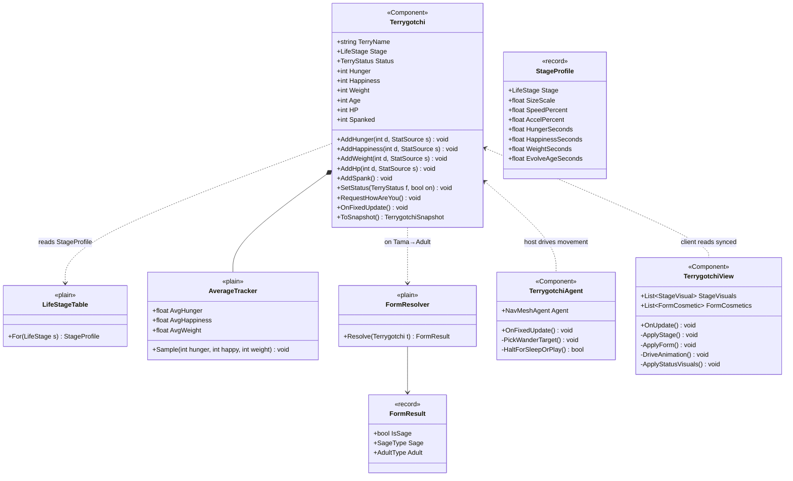

Notes:
- **Synced fields** (`[Sync(SyncFlags.FromHost)]`): `TerryName`, `Stage`,
  `Status`, the five primary values, `Spanked`. `TerrygotchiView` (running on all
  machines incl. proxies) reads these; only the host writes them.
- The `Add*` methods are the **P2 choke point**. They are the *only* writers of
  the primary values. They apply: min-clamp, Misbehaving tax, source-aware illness
  caps, Sausage/Sage pinning, Immortality. Clamping is an inline helper on `Terrygotchi`.
- Per-Terry timers (Illness, Misbehave, Immortality, Averages, Revive) and the
  rate timers (Hunger/Happiness/Weight decay, HP recover) are `RepeatingTimer`
  fields ticked in `Terrygotchi.OnFixedUpdate` under the host gate. Rate intervals
  and evolve gates come from `SessionConfig.Rates` (a `RatesConfig`, defaults
  sourced from `LifeStageTable`; evolve gate 0 = never); all other per-Terry timer
  intervals come from `SessionConfig` directly, in real seconds — no runtime
  multiplier (Q4, removed; see `IMPLEMENTATION_STATUS.md`).
- `FormResolver` is a **pure function** of final values + averages + `Spanked` —
  no engine deps, trivially testable. Sage wins over Adult; ties broken randomly.
- **Visuals are a single prefab with a child GameObject per stage** (decision from
  build feedback — *not* per-stage prefabs and *not* runtime model swapping).
  `TerrygotchiView` **toggles** the current `Stage`'s child on and the others off
  (mapped via the `StageVisuals` list, or auto-discovered by child name), and
  toggles a **final-form cosmetic** child (horns, angel wings, sword, …) via
  `FormCosmetics`. Each machine drives the toggles locally from the synced
  `Stage`/form. Animation/tint act on the active child's renderer. A code-built
  fallback (single citizen renderer) runs only when no prefab is assigned (dev).
- **Wandering [IMPLEMENTED — spec in `Design.md`].** `TerrygotchiAgent` owns the per-stage
  wander. Each second (real-time, not difficulty-scaled), a per-stage `WanderChance` may pick a
  navmesh point (`Scene.NavMesh.GetRandomPoint`) in `[MinDistance, MaxDistance]`; a per-stage
  `RunChance` upgrades the trip to a run (`RunSpeed`) vs a walk (`WalkSpeed`). Sausage is excluded;
  sleep/play/evolving/death halt it. Real values live in `SessionConfig.Wander`
  (`WanderConfig` + `WanderStage` plain classes, per-stage + stage-independent `MinDistance`) — they are
  host-tunable in `HostConfigScreen` and part of the leaderboard-eligibility equality. The design's
  1-5 ranks were mapped to starting reals (tune via playtest). TODO: per-`SageType` modification
  (Sage wander is currently uniform across the four Sage types).
- **Thought-bubble communication [IMPLEMENTED — Design.md "Thought-Bubble (Terrygotchi-Player
  Communication)"].** `Terrygotchi` also owns a per-Terry `TerryCommunication` (plain class, like
  `AverageTracker`): a *read-one-at-a-time* bubble queue plus an unprompted-trigger monitor (misbehave
  onset, illness onset, hunger/happiness range crossings). Ticked under the host gate in
  `OnFixedUpdate`; the prompted `zHowAreYou` path enqueues two frames (hearts then smileys) via
  `RequestHowAreYou`. The bubble rendered is the §4.4 `ThoughtBubble` prefab. See §4.4 and §6.8.

Both Twitch messages (host) and in-game button presses (client RPC) normalise to
one `ChatCommand`, then one `CommandRouter` validates and dispatches. This is the
single most reused path in the game.

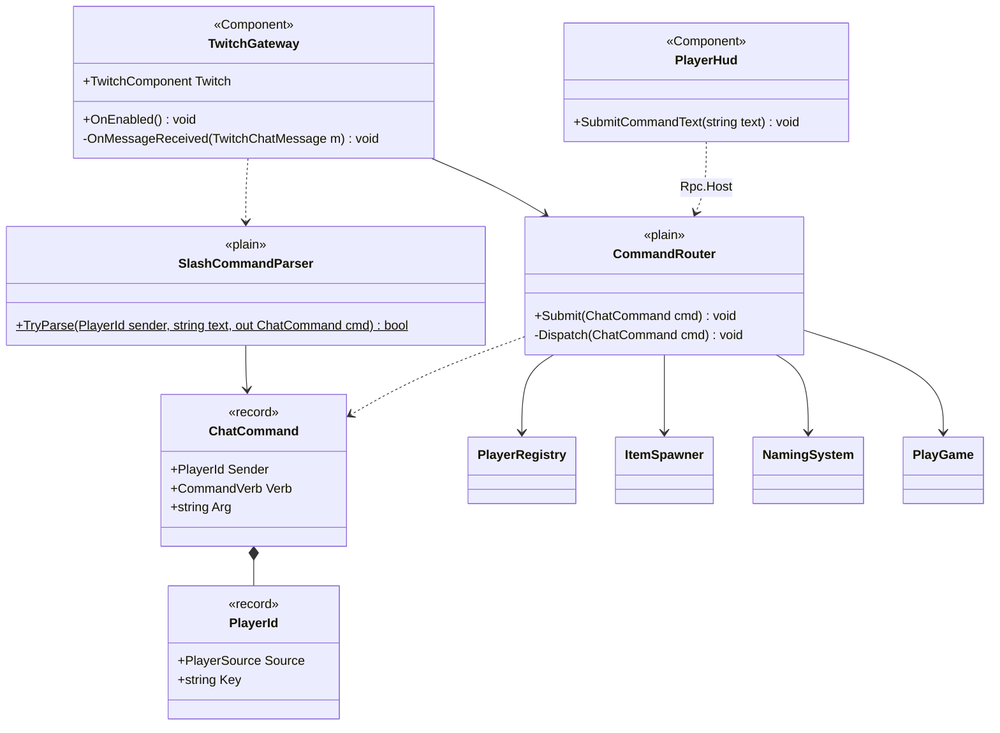

Notes:
- `TwitchGateway` wraps the library `TwitchComponent` (host-side; raises
  `OnMessageReceived(TwitchChatMessage{Username,Message})`). It parses and submits
  to the router, **and** relays the raw line to clients via `ChatRelay` (the
  in-game chat box mirrors Twitch).
- Client commands arrive as a `[Rpc.Host]` from `PlayerHud` carrying the raw
  command text; the host stamps the caller's `PlayerId` (do **not** trust a
  client-supplied identity — use the RPC caller `Connection`; confirm `Rpc.Caller`
  per Q3) and feeds the same parser.
- `CommandRouter.Dispatch` resolves `Sender → paired Terrygotchi`, enforces
  guards (pairing required for actions; cooldowns for `zNewTerry` and `zPlay`;
  sleep blocks most actions), then:
  - pairing verbs → `PlayerRegistry` / `NamingSystem` / `TerrygotchiFactory`
  - action verbs → `ItemSpawner.SpawnAbove(terry, type)`
  - numeric guesses during an active game → `PlayGame.SubmitGuess`

### 4.4 Interaction layer — spawned items

Every action verb clones a short-lived networked **item prefab** above the Terry. Each
prefab carries a **Rigidbody** (so it falls straight down under gravity), a **physical
collider**, a **larger trigger collider**, and its item Component. The item is **not**
steered toward the Terry — if the Terry wanders the item falls past and times out; you
rely on the trigger volume catching the Terry as it drops. On the Terry entering the
trigger (`ITriggerListener.OnTriggerEnter`), it applies its effect through the **P2
mutation API** and despawns. `Design.md`: "most interactions involve spawning an object
near their Terrygotchi."

Prefabs are authored under `Assets/Prefabs/` (cake, potato, bleach, painkiller, antiviral,
spank, tickle, poop), assigned on `GameManager`'s prefab fields, threaded into
`SessionDirector.ItemPrefabs`, and cloned by `ItemSpawner`. Paired kinds share one
Component class with a toggle authored on the prefab (Cake/Potato → `FoodItem`,
Painkiller/Antiviral → `MedicineItem`, Spank/Tickle → `GloveItem`); `ItemSpawner` only
wires the paired `Target`/`Owner` on the clone. `ThoughtBubble` is now **also a prefab**
(`Assets/Prefabs/thoughtbubble.prefab` — a cloud + a child `TextRenderer`); it is still
**standalone** (no physics, no trigger — view-only) and is driven by the per-Terry
`TerryCommunication` queue rather than spawned directly by an action verb (see §4.4a).

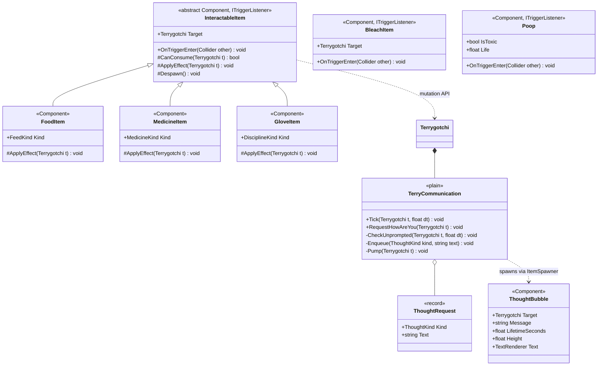

Notes:
- The prefab's Rigidbody makes the item fall; `InteractableItem` itself only runs a
  host-gated lifetime countdown (`OnFixedUpdate`) and, on the paired Terry entering its
  trigger (`OnTriggerEnter`), checks `CanConsume`, calls the abstract `ApplyEffect`, and
  despawns. Never-reached items despawn at `LifetimeSeconds`.
- `BleachItem`, `Poop`, and `ThoughtBubble` are **standalone** Components (not
  `InteractableItem` subtypes), because they don't follow the eat-then-despawn path:
  Bleach falls onto the Terry and deletes the first `Poop` its trigger overlaps; toxic
  `Poop` hits its owner for −5 Happiness when the owner enters its trigger, then deletes.
  `Poop` is spawned by the Terry's Weight-Check, ages via `ToxicPoopTimer`
  (`ItemSpawner.AgeAllPoop`), and flips `IsToxic`.
- `ThoughtBubble` is view-only and carries no stat effect: it hovers above the Terry's head at
  `Height`, writes its synced `Message` into the child `TextRenderer`, and host-gated self-destructs
  after `LifetimeSeconds`. It no longer computes `Hearts`/`Smileys` counts — the **text** of every
  bubble (heart/smiley glyphs for `zHowAreYou`, emoticon strings for warnings) is decided by
  `TerryCommunication` and passed in at spawn (§4.4a). `Message` is `[Sync(FromHost)]`, so client
  proxies render the same text.

### 4.4a Thought-bubble communication (Terrygotchi → player)

Design.md "Thought-Bubble (Terrygotchi-Player Communication)". One per-Terry plain class,
`TerryCommunication`, owned by `Terrygotchi` (like `AverageTracker`) and ticked under the host gate.
It is the **`ThoughtBubbleSpawnInstance` queue** plus the unprompted-trigger monitor.

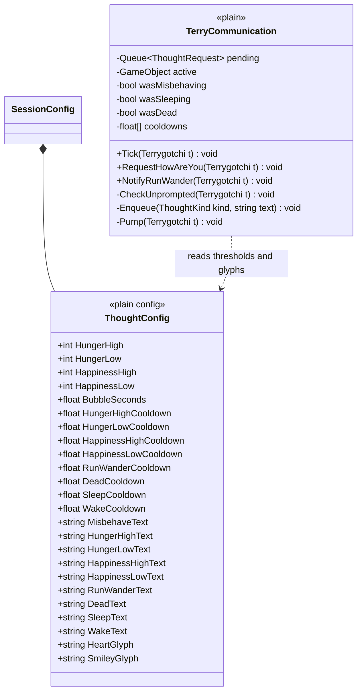

- **Queue, read-one-at-a-time.** Every prompted or unprompted call `Enqueue`s a `ThoughtRequest`
  (`Kind` + already-resolved `Text`). `Pump` spawns the next bubble **only when none is active** (the
  previously spawned bubble GameObject has expired), so each message gets its full read time instead of
  stacking on top of the last.
- **Prompted (`zHowAreYou`).** `CommandRouter` calls `Terrygotchi.RequestHowAreYou()` →
  `TerryCommunication.RequestHowAreYou(t)`, which enqueues **two** frames: hearts first
  (`HeartGlyph` × `IconsFor(HP)`), then smileys (`SmileyGlyph` × `IconsFor(Happiness)`). Counts use the
  existing `<=3 / 4-5 / 6-8 / >8 → 1/2/3/4` thresholds. The router no longer routes `HowAreYou` through
  `ItemSpawner.SpawnAbove`.
- **Unprompted level warnings (host tick).** `CheckUnprompted` watches, per `ThoughtConfig`, with one
  cooldown each: misbehave **onset** (edge, no cooldown), illness **onset** (edge, no cooldown), Hunger > `HungerHigh`, Hunger < `HungerLow`,
  Happiness > `HappinessHigh`, Happiness < `HappinessLow`. Skipped for Sausage/Sage (pinned values) and
  while Dead/Evolving/Sleeping. A fired trigger arms its **own per-type cooldown**
  (`HungerHighCooldown`, …) so the player is not nagged again for that many seconds.
- **Edge events (fire even in suppressed states).** Detected before the suppression gate, each
  cooldown-throttled:
  - **Run-wander start** → `RunWanderText`. `TerrygotchiAgent` calls `Terrygotchi.OnRunWanderStarted()` →
    `NotifyRunWander` when a wander roll upgrades to a run.
  - **Death onset** → `DeadText`. **First wipes the pending queue, destroys any active bubble** (so a
    stale happy face does not linger over the corpse), then **refreshes ALL per-type cooldowns to ready**
    so a revived Terry is not gagged by throttles from its previous life — and shows the death emoticon
    once. No other bubbling happens while Dead.
  - **Sleep onset** → `SleepText`; **wake** (sleep offset, still alive) → `WakeText`.
- **Cooldowns are real-time and per-type.** Each communication type has its **own** cooldown value
  (`HungerHighCooldown`, `RunWanderCooldown`, `DeadCooldown`, …) and its own timer, drained on
  `Time.Delta` (NOT sim-scaled `dt`): a cooldown is a "don't nag me again for N seconds" wall-clock
  throttle and must not speed up when `SimSpeed` is raised. Misbehave and prompted `zHowAreYou` have no
  cooldown. (Bubble lifetime is likewise real seconds.)
- **Spawn.** `Pump` calls `ItemSpawner.SpawnThoughtBubble(t, text, BubbleSeconds, Height)` (host-only),
  which clones `ItemPrefabs[ItemType.ThoughtBubble]`, sets `Target` + `Message`, and `NetworkSpawn`s. The
  bubble faces the active `Scene.Camera` itself (prefab `TextRenderer.Billboard = None`; the component
  orients toward the single enabled main camera, since two equal-priority cameras make engine billboarding
  ambiguous).

### 4.5 Play mini-game

Session-scoped Hi/Lo guessing state machine; only one active at a time; gated by
the Play Timer. Collects guesses over a vote window and takes the **median**.

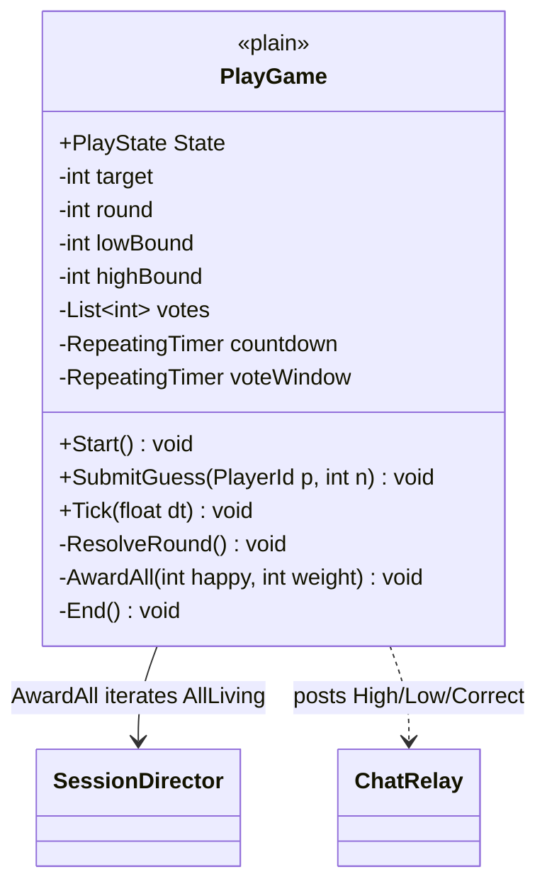

Rewards (correct at round 1/2/3 → +3/−2, +2/−1, +1/−1 to every living Terry) go
through the P2 mutation API with `StatSource.PlayReward`. Putting every Terry into
`Playing` status is the session's job when a game is active (`Play` overrides
next-action selection except `Sleep`).

### 4.6 Presentation layer (camera split + client UI)

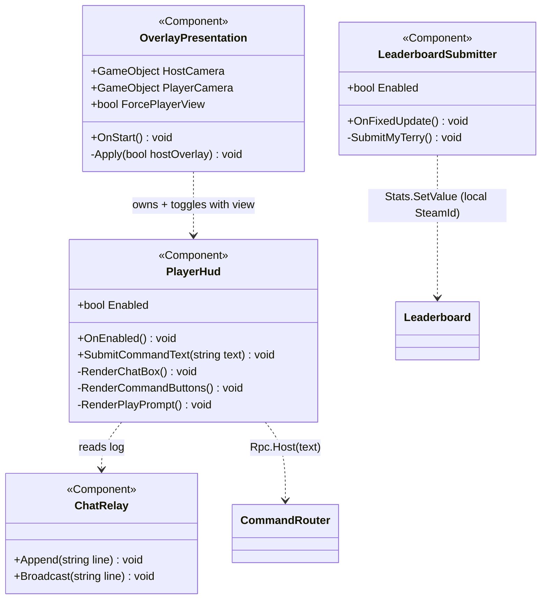

Notes:
- **Two presentation modes, decided by host/client role (`Globals.HasAuthority`;
  pre-lobby counts as host) plus the `ForcePlayerView` solo override:**
  - **Host = the overlay.** The scene-authored **`HostCamera`** GameObject
    (greenscreen shot, chroma-keyable in OBS); **no UI**.
  - **Client = a player view.** The scene-authored **`PlayerCamera`** GameObject
    (3D 3/4 view); `PlayerHud` enabled, showing the command buttons and
    Twitch-chat mirror.
  `OverlayPresentation` only **switches** between the two camera GameObjects
  (refs are inspector-wired on the scene's `GameManager` and injected at
  bootstrap — `OverlayPresentation` itself is code-created); all
  framing/FOV/background/post-processing is authored on the cameras in the
  editor, never set from code. Exactly one camera
  object is enabled at a time. It re-applies whenever the desired view changes
  (lobby host/client resolution, the config screen's Solo Offline toggle, or the
  in-session Ctrl+Shift+O chord). The machine's single `PlayerHud` is scene-authored
  on `GUICode` (authored disabled) and injected into `OverlayPresentation` by
  `GameManager`; enabling/disabling the `PanelComponent` is itself show/hide.
- Characters live on a floor with some forward/back navmesh movement and **may
  fall off the front**; the existing `Respawner` (`FallLimit` / `SpawnPos`)
  teleports them back after an arbitrary drop — keep/repurpose it rather than
  reinventing.
- `PlayerHud` is a **razor `PanelComponent`** (`PlayerHud.razor` + `.razor.scss`), shown for the
  client/player view only (Phase 2 of the razor rewrite — `RazorRewritePlan.md` §6.2,
  `IMPLEMENTATION_STATUS.md` §0i; `HostConfigScreen` is razor too, §0h). The old note that "Razor needs
  the editor compile pipeline" was wrong: shipped `Sandbox.Razor.dll` exposes
  `RazorProcessor.GenerateFromSource`, so razor is transpiled + compiled offline in terrygotchi-verify.)
- Buttons map 1:1 to z-prefixed commands and **auto-target the local player's** Terry
  (the host resolves "self" from the RPC caller `Connection`). The HUD also has a name
  field + New/Pair/Release buttons for pairing.
- **`HostConfigScreen`** (razor `PanelComponent`, scene-authored on the `GUICode` GameObject,
  host-only — see `IMPLEMENTATION_STATUS.md` §0h) shows **before the room is
  live** and gates the lobby + sim: the host picks difficulty (Realistic/Daily/Debug),
  permadeath, and Twitch channel, then **Start** -> `SessionDirector.StartSession(cfg)`
  + `Networking.CreateLobby`. `SessionDirector.SessionStarted` keeps everything frozen
  until then. (`NetworkHelper.StartServer` is forced false so nothing auto-creates the lobby.)
- `ChatRelay` keeps a networked/RPC-fed log so the in-game box mirrors Twitch plus
  system lines (Play prompts, High/Low/Correct). Host → clients via
  `[Rpc.Broadcast]`.
- `LeaderboardSubmitter` is a **client-side** component (not visual): when the
  local player is paired to a Terry and `Config.IsDefaultProfile`, it reads that
  Terry's host-synced `Age`/`TerryName` and submits via `Stats.SetValue` on a
  cadence and at death. Because `Stats.SetValue` submits for the local SteamId,
  this is what makes an in-game client player's Terrygotchi contribute to the
  leaderboard **under their own account** (§4.1). The host runs its own instance
  only for any Twitch-only Terries (optional — see §4.1).

### 4.7 Persistence layer

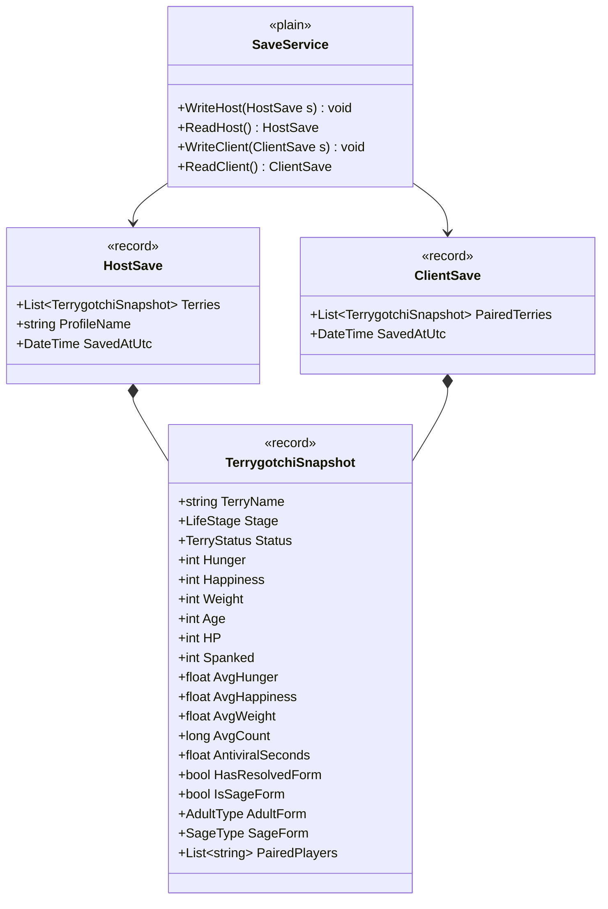

Notes:
- Persisted via `FileSystem.Data.WriteJson<T>` / `ReadJson<T>` (verified — see §9 Q3 / §11).
- **Host save:** all spawned-and-alive Terries, plus dead-but-not-permadeath ones.
  **Death status is not saved** (a revived/loaded Terry is alive). Includes
  statuses Illness/Misbehaving, averages, antiviral accumulation, resolved adult/sage
  form, and paired players. The save stores only the difficulty `ProfileName` (not the
  whole `SessionConfig`); the host re-chooses config each session (see
  `IMPLEMENTATION_STATUS.md` §6).
- **Client save:** only Terries this client paired to at least once, at
  disconnect-state.
- No offline catch-up: a loaded Terry resumes at its saved values (incl. `Age`)
  and continues in scene time. See §7.

### 4.8 Shared utilities

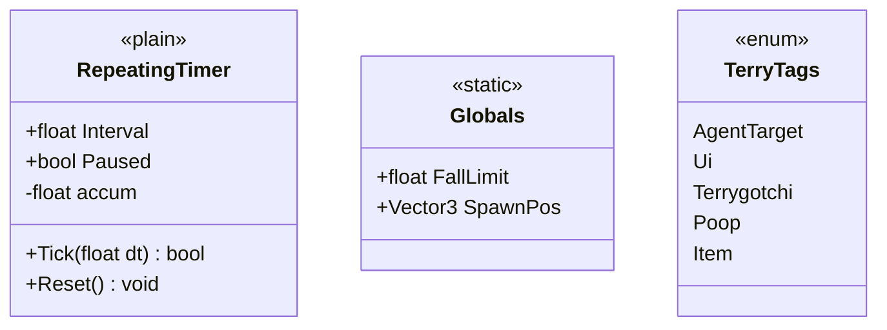

`RepeatingTimer` uses a manual accumulator (not raw `TimeSince`) so `Paused` is
trivial and resuming never fires a catch-up burst — exactly what the night-time
pause needs. Fed `Time.Delta` each host fixed-tick. Fires every `Interval` real
seconds — no runtime multiplier (Q4, removed; see `IMPLEMENTATION_STATUS.md`).

---

## 5. Enums & state reference

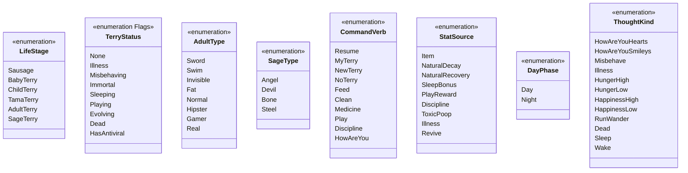

Plus small kind enums: `FeedKind{Cake,Potato}`, `MedicineKind{Painkiller,Antiviral}`,
`DisciplineKind{Spank,Tickle}`, `ItemType{Cake,Potato,Bleach,Painkiller,Antiviral,SpankGlove,TickleGlove,ThoughtBubble,Poop}`,
`StatKind{Hunger,Happiness,Weight,HP}`, `PlayState{Idle,Countdown,Voting,Resolved}`,
`PlayerSource{Twitch,Client}`.

**`TerryStatus` is `[Flags]`** — statuses stack ("not mutually exclusive", e.g.
`Illness | Misbehaving`). `LifeStage` is a single monotonic value. Keep them
separate; do **not** fold them into one state machine.

---

## 6. Sequence diagrams (the dynamic behaviour)

### 6.1 Action command from Twitch (e.g. `zFeed Cake`)

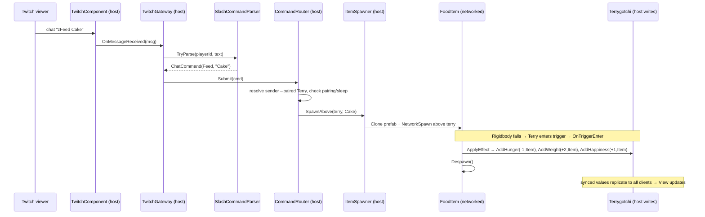

### 6.2 Action command from in-game client button

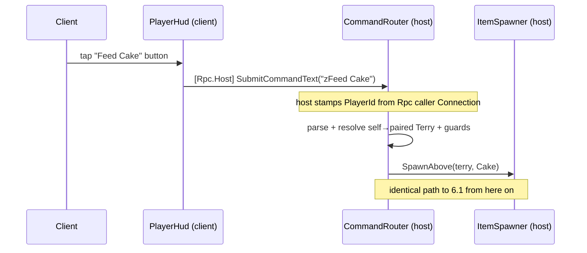

### 6.3 Age-up and evolution (incl. Sage vs Adult branch)

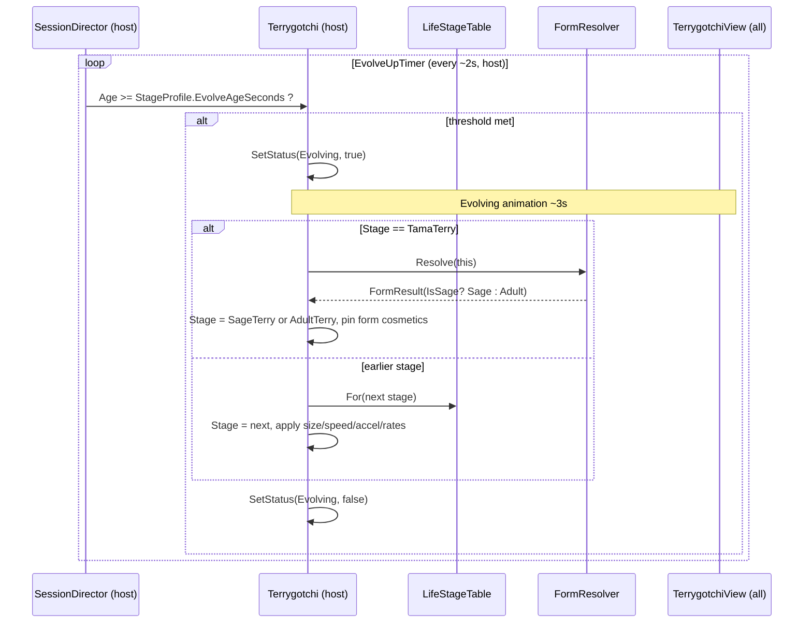

### 6.4 Illness → HP loss → death → revive (and "ill twice = death")

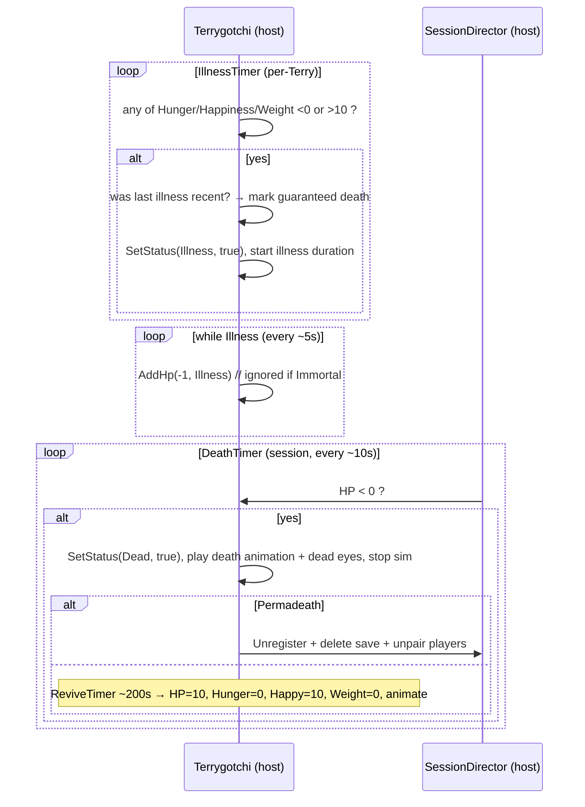

### 6.5 Play mini-game

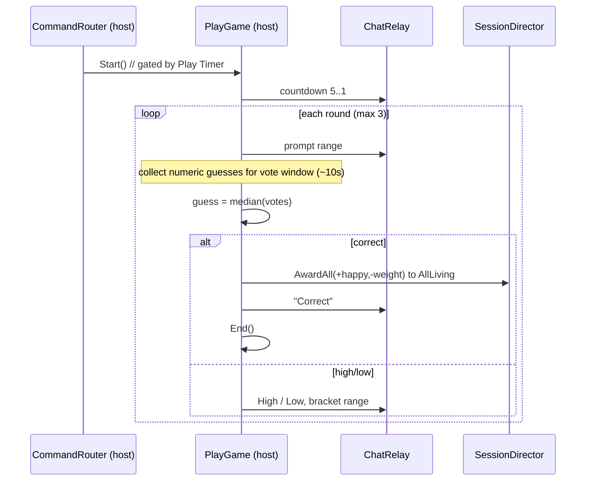

### 6.6 Session start + player join

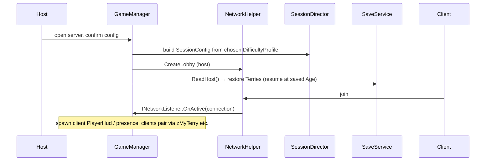

### 6.7 Save on disconnect / load

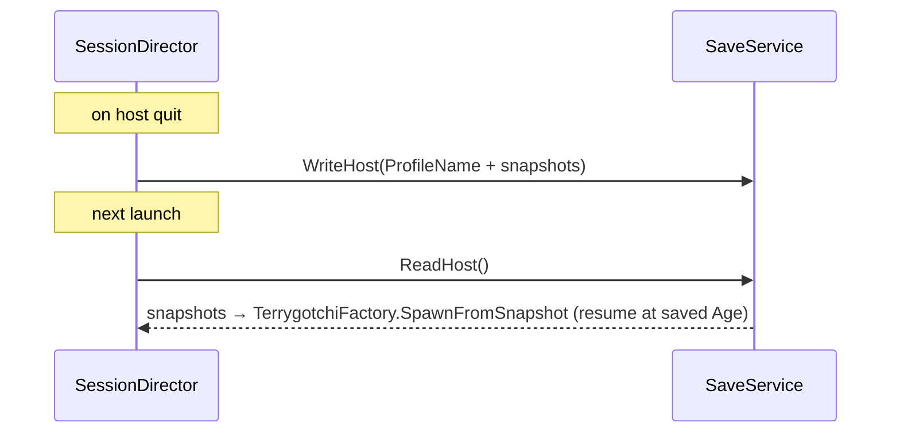

### 6.8 Thought-bubble communication (prompted and unprompted)

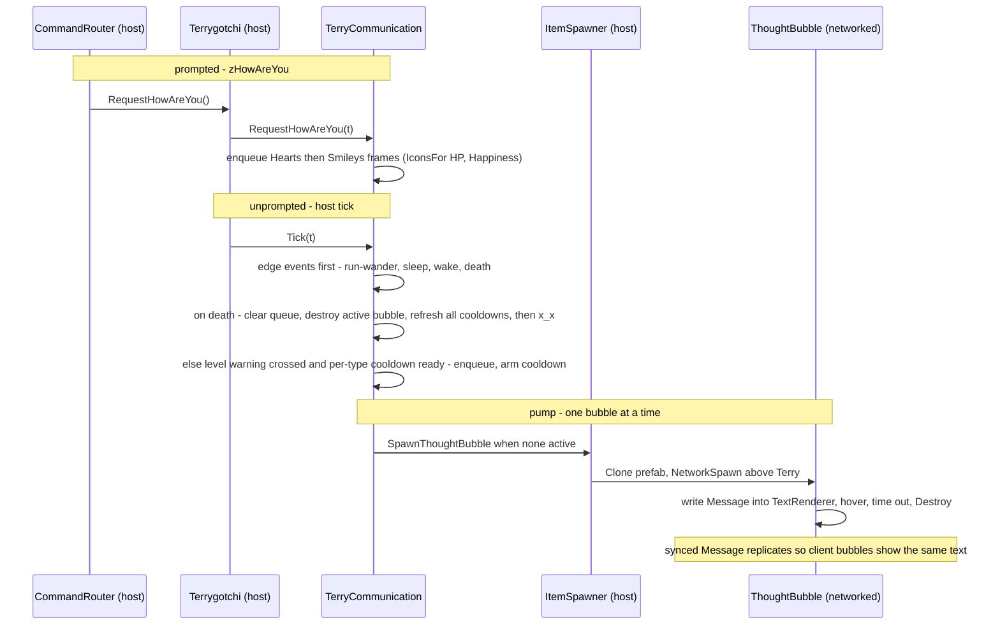

---

## 7. Persistence: Age and timers across sessions

- **Live ticking** uses `RepeatingTimer` (accumulator over `Time.Delta`) inside
  host-gated `OnFixedUpdate`. Pausable for night. This is the only ticking path.
- **Timers do not persist** across sessions — they reset. The only thing carried
  across a save/load is **state values**, and `Age` is the one that matters for
  continuity: it is saved as an `int` and the Terry resumes counting from it.
- **No offline catch-up.** The "age while offline" toggle is disabled, so there is
  no fast-forward on load — a loaded Terry simply continues from its saved values
  in real session time. The leaderboard's seconds-alive is just `Age`.

---

## 8. Traceability: Design.md → classes

Every rule has exactly one home. If you can't find where a rule goes, the
architecture is missing something — flag it.

| Design.md element | Owner type(s) | Scope |
|---|---|---|
| Primary values (Hunger/Happiness/Weight/Age/HP) | `Terrygotchi` (`[Sync]` properties) | per-Terry |
| Spanked counter | `Terrygotchi` | per-Terry |
| Minimum value −1, Misbehaving tax, illness caps | `Terrygotchi.Add*` (P2) | per-Terry |
| Rates (per-stage decay/recover) | `RepeatingTimer` in `Terrygotchi`, intervals from `SessionConfig.Rates` (defaults: `LifeStageTable`) | per-Terry |
| Aging / evolve thresholds | `TerrygotchiLifecycle` logic in `Terrygotchi` + `EvolveUpTimer` | both |
| Life stages + size/speed/accel | `LifeStage`, `StageProfile`, `LifeStageTable` | per-Terry |
| Adult forms (8) | `FormResolver` → `AdultType` | per-Terry |
| Sage forms (4) | `FormResolver` + `AverageTracker` → `SageType` | per-Terry |
| Death / revive / permadeath | `Terrygotchi` health + `DeathTimer` (session) + `ReviveTimer` (per-Terry) | both |
| Illness | `IllnessTimer` + `Status.Illness` in `Terrygotchi` | per-Terry |
| Misbehaving | `MisbehaveTimer` + `Status.Misbehaving` | per-Terry |
| Immortality | `ImmortalityTimer` + `Status.Immortal` | per-Terry |
| Averages tracking | `AverageTracker` + `AveragesTimer` | per-Terry |
| Antiviral accumulation + `HasAntiviral` | `Terrygotchi` + `MedicineItem` | per-Terry |
| Weight-Check → poop | `Terrygotchi` (spawns `Poop` via `ItemSpawner`) | per-Terry |
| Toxic poop | `Poop` + `ToxicPoopTimer` (session) | both |
| Death Timer, Evolve-Up Timer, Day/Night, Toxic Poop Timer | `SessionDirector` / `DayNightCycle` | session |
| Play Timer / countdown / vote | `PlayGame` | session |
| New Terry cooldown (per player) | `PlayerRegistry` | session |
| Sleep / day-night, wake bonus, night pause | `DayNightCycle` + `SessionDirector.SetNightPause` | session |
| Play Game (rounds, median, rewards) | `PlayGame` | session |
| Leaderboards (seconds-alive, default profiles only) | `Leaderboard` → `Sandbox.Services`; per-client submit via `LeaderboardSubmitter` | session + client |
| Naming (unique, reserved, pairing) | `NamingSystem` + `PlayerRegistry` | session |
| Chat commands (parse + dispatch) | `SlashCommandParser` + `CommandRouter` | session |
| Twitch ingestion + mirror | `TwitchGateway` + `ChatRelay` | host/client |
| Client UI (chat box, buttons) | `PlayerHud` | client |
| Camera split: switches scene HostCamera (greenscreen, no UI) / PlayerCamera (3D 3/4, HUD) | `OverlayPresentation` | host & client |
| Fall off front → auto-teleport back | `Respawner` | per-Terry |
| Spawned items (cake/potato/bleach/pills/gloves) | `InteractableItem` subtypes | per-item |
| Thought-bubble communication: prompted zHowAreYou (hearts then smileys); unprompted level warnings (misbehave/illness onset, hunger/happiness crossings); edge events (run-wander, death with queue-wipe, sleep, wake); real-time per-trigger cooldowns; read-one-at-a-time queue | `TerryCommunication` (per-Terry queue + triggers) + `ThoughtBubble` (prefab text view, faces `Scene.Camera`) + `ItemSpawner.SpawnThoughtBubble`, tunables in `ThoughtConfig` | per-Terry |
| Configurable options (Permadeath, tunables, difficulty) | `SessionConfig` + `DifficultyProfile` | session |
| Saving (host + client) | `SaveService`, `*Save`, `TerrygotchiSnapshot` | session |
| Movement / AI / action override | `TerrygotchiAgent` | per-Terry, host |
| Stage/form visuals (toggle prefab child per stage + cosmetic per form), animation, tint, icons | `TerrygotchiView` | per-Terry, all |

---

## 9. Open design questions (resolve before or during build)

Most are now resolved (marked inline); only **Q3** (engine API confirmations)
remains open.

- **Q1 — Player identity. [RESOLVED — Option A.]** Two independent namespaces:
  `PlayerId{Source: Twitch|Client, Key}`. A Twitch viewer (keyed by username) and
  a lobby client (keyed by `Connection`/SteamId) are distinct players even if the
  same human — Design.md line 47: the session "doesn't care"; one human may pair
  to the same Terry (or different ones) via both surfaces. Security rule: derive a
  client's identity from the RPC caller `Connection`, never from the message body.
- **Q2 — Play guess recognition. [RESOLVED — Option A.]** While
  `PlayGame.State == Voting`, a bare integer in the active range is a vote; all
  other text parses as a command. Rules: out-of-range ignored; one vote per
  `PlayerId`, last-wins; even-count median rounds half-up; an empty round counts
  as not-correct (advance/end); anyone in chat may vote (not gated by pairing).
  `CommandRouter` tries integer-as-vote first while a game is voting.
- **Q3 — Engine API confirmations. [RESOLVED — all verified against
  `2-sbox-public`.]**
  - **RPC caller:** inside a `[Rpc.Host]` method, `Rpc.Caller` is the calling
    `Connection` (`Rpc.CallerId` is its `Guid`). The host stamps `PlayerId` from
    this — never from the message body.
  - **Persistence:** `FileSystem.Data.WriteJson<T>(path, obj)` and
    `ReadJson<T>(path, default)` (plus `WriteAllText`/`ReadAllText`/`FileExists`).
    Example: `FileSystem.Data.WriteJson( "hostsave.json", hostSave );` then on load
    `var save = FileSystem.Data.ReadJson<HostSave>( "hostsave.json" );`.
  - **Leaderboard:** **use `Sandbox.Services`** (per decision). Submit
    `Stats.SetValue(stat, value, Dictionary<string,object> data)` — the data dict
    (e.g. `{"terry": name}`) is JSON-serialized and travels with the stat. Read via
    `Leaderboards.GetFromStat(stat)` → `Board2`, `await Refresh()`; each `Entry`
    exposes `DataUrl` (fetch the JSON to read the Terry name — inline `Entry.Data`
    is `[Obsolete]`). Residual: SteamId-keyed → one row per streamer (best Terry),
    see §4.1. (Source-verified against `2-sbox-public`; a live backend round-trip
    needs a published package + authed session.)
- **Q4 — Difficulty scaling math. [RESOLVED — implemented per `Design.md`'s literal
  CUMULATIVE reading.]** `Design.md` lists the evolve gates as cumulative ages
  (Sausage 60, Baby 120, Child 210, Tama 300) → a **300 s 1× floor to Adult** (NOT the
  ~690 s an earlier draft of this section got by summing them as per-stage durations).
  A shared factor (`DifficultyProfile.TimeScale`, a float ≥ 0, customizable down to 0)
  multiplies the floor; the leaderboard anchors divide into 300 s as clean integers, so
  **Realistic = ×336 → 100,800 s** and **Daily = ×48 → 14,400 s** (in code:
  `DifficultyProfile.Realistic()`/`.Daily()`). Only these two feed the leaderboard.
  (See `IMPLEMENTATION_STATUS.md` §1 — flagged for owner confirmation.)
  - *Follow-on [RESOLVED — scale care-rates and timers too]:* `TimeScale`
    multiplies the **age thresholds** and the **care-rate intervals**
    (hunger/happiness/weight decay, HP recover); **`Age` alone is exempt** (stays
    +1 per real second so leaderboard seconds-alive is real time). Expect heavy
    balancing.
    - *Caution — don't blindly scale every timer.* The per-Terry life-sim timers
      (Illness, Misbehave, Immortality, Averages, Revive) reasonably scale, but the
      **session-rhythm / check-granularity** timers should be judged individually:
      a ×336 Day/Night cycle is a ~28-hour Realistic daytime, and a ×336 Play
      cooldown or Death-check is nonsense. Those should stay fixed (or use a
      separate, gentler curve). So each `RepeatingTimer` carries a
      `ScalesWithDifficulty` flag (§4.8) and opts in.
  - *Follow-on [REMOVED — `TimeScale` mechanism cut, see `Remove-Timescale-Plan.md`].*
    The runtime multiplier added too much overhead for too little payoff. `RepeatingTimer`,
    `DifficultyProfile`, and every consumer now run on the `Interval`/`*Seconds` value as
    authored, full stop — no `× TimeScale`, no `ScalesWithDifficulty` flag. Realistic/Daily
    keep their distinct pacing by having their **own authored `*Seconds`/`Rates` values**
    baked directly into each preset's `SessionConfig` (manually reauthored in `main.scene`),
    not by a shared multiplier. The ×336/×48 ratios above are the historical derivation of
    those baked values, not a live mechanism.
- **Q5 — Offline aging. [RESOLVED — cut.]** The "age while offline" toggle is
  disabled (Design.md, struck through). No `CatchUpSimulator`, no `DateTime`
  catch-up, no two-clock problem; `Age` persists as a saved `int` and the Terry
  resumes counting in scene time. See §7.
- **Q6 — 2D / camera split. [RESOLVED.]** 3D models on a floor with some
  forward/back navmesh movement; they may fall off the front and are
  auto-teleported back after an arbitrary drop (`Respawner`, already scaffolded).
  **Host** overlay = the scene's `HostCamera` (greenscreen shot), no UI.
  **Client** = the scene's `PlayerCamera` (3D 3/4 view) + command buttons +
  Twitch chat. `OverlayPresentation` (§4.6) switches between the two camera
  GameObjects and toggles the HUD by host/client role. Per-entity visuals still
  live in `TerrygotchiView`.

---

## 10. Suggested build order

> **All nine milestones are implemented (2026-06-11).** This section is retained as the historical
> build order and milestone map; `IMPLEMENTATION_STATUS.md` records what shipped and where it
> deviated. Present-tense references below (e.g. the placeholder `TerrygotchiController`) describe
> the pre-build starting point, not the current tree.

Each milestone is independently runnable in the editor.

1. **Scene + bootstrap (the scene already exists — fix, don't re-create).**
   `Assets/scenes/minimal.scene` is present and is the resolved `StartupScene`; it
   already carries a `Code` GameObject with `GameManager` + `NetworkHelper`, a
   floor, a camera, and two `agenttarget` run points. Reconcile the **dangling
   `Sandbox.PlayerHud` reference** and the **disabled Twitch *example* panel** in
   that scene, switch the camera toward the greenscreen overlay, and confirm it
   loads. See `For_Plan_Executioner_Lead_Developer.md` §2 and §6 for the verified
   scene contents.
2. **`Terrygotchi` aggregate + P2 mutation API.** Synced values, `LifeStage`,
   `TerryStatus`, the `Add*` choke point with clamps/caps. No timers yet. Spawn one
   by hand; verify values replicate to a second client.
3. **`RepeatingTimer` + rates + Evolve-Up + evolution.** `LifeStageTable`,
   `TerrygotchiLifecycle`, `EvolveUpTimer`. Watch a Sausage walk the stages. Replace
   the placeholder ping-pong AI in `TerrygotchiController` with
   `TerrygotchiAgent` + `TerrygotchiView` once state exists.
4. **Command pipeline.** `ChatCommand`/`SlashCommandParser`/`CommandRouter`, then
   re-establish Twitch via `TwitchGateway` (the old connector was deleted;
   `carsonk.twitchapi` is still referenced). Start with `zNewTerry`, `zMyTerry`,
   `zNoTerry`. Make the channel host-configurable (old hardcoded `"escgabe"`).
5. **Items + actions.** `InteractableItem` hierarchy + `ItemSpawner`; wire `zFeed`,
   `zClean`, `zMedicine`, `zDiscipline`, `zHowAreYou`. Trigger-collision effects.
6. **Health systems.** Illness/Misbehave/Immortality/Death/Revive timers; poop +
   toxic poop + Weight-Check.
7. **Session systems.** `DayNightCycle` (+ night pause + wake bonus), `PlayGame`,
   `FormResolver` Sage/Adult, `Leaderboard`.
8. **Persistence.** `SaveService` host/client; a loaded Terry resumes at its saved
   `Age`. (Offline aging is cut — no `CatchUpSimulator`.)
9. **Presentation.** `OverlayPresentation` camera split (host ortho greenscreen /
   client 3D 3/4); `PlayerHud` chat box + buttons + `ChatRelay` Twitch mirror.

---

## 11. Verified engine API touch-points

Confirmed against `2-sbox-public` this session — the design relies only on these.

| Concern | Symbol (verified) |
|---|---|
| Component lifecycle | `Component.OnAwake/OnStart/OnEnabled/OnUpdate/OnFixedUpdate/OnLoad` |
| Editor config | `[Property]`, `[RequireComponent]`, `Group("...")` |
| Networked value | `[Sync]`, `[Sync(SyncFlags.FromHost)]`, `SyncFlags{FromHost,Query,Interpolate}` |
| RPC | `[Rpc.Broadcast]`, `[Rpc.Host]`, `[Rpc.Owner]`, `NetFlags` |
| Lobby / spawn | `NetworkHelper`, `Networking.CreateLobby`, `Networking.IsActive`, `Networking.IsHost`, `GameObject.Clone(...)`, `GameObject.NetworkSpawn(Connection)`, `Component.INetworkListener.OnActive(Connection)`, `NetworkObject.IsProxy` |
| Timers (primitives) | `TimeSince`, `TimeUntil`, `Time.Now`, `Time.Delta` |
| Item/Terry contact | **trigger collider** (`Component.ITriggerListener.OnTriggerEnter`, host-gated) on the item prefab; effect resolves the entering `Collider` to its `Terrygotchi` via `GetComponentInParent<T>()` |
| Component add/find (code-built) | `GameObject.Components.Create<T>()` / `GetOrCreate<T>()`, `GameObject.GetComponentInChildren<T>()`, `GameObject.Clone(...)` |
| Scene queries | `Scene.FindAllWithTag`, `Scene.GetAllComponents<T>()`, `Scene.IsEditor` |
| Movement / anim | `NavMeshAgent`, `Sandbox.Citizen.CitizenAnimationHelper` |
| Scene-wide system (alt) | `GameObjectSystem` (+ `Listen(Stage,...)`) |
| Twitch (library) | `TwitchAPI.TwitchComponent` (host), `TwitchChatMessage{Username,Message}` — the native engine API (`Sandbox.Streamer` + `Streamer.IEvents`, added 2026-06) was evaluated and **kept out**: it reads only the linked account's own channel, needs the account link + "streamer game" flag, and offers no game-initiated connect; we need host-named, anonymous, on-demand channel reads. See `IMPLEMENTATION_STATUS.md` §6b. |
| Persistence | `FileSystem.Data.WriteJson<T>` / `ReadJson<T>` (+ `WriteAllText`/`ReadAllText`/`FileExists`) |
| RPC caller | `Rpc.Caller` (`Connection`), `Rpc.CallerId` (`Guid`) |
| Leaderboards / stats | `Sandbox.Services.Stats.SetValue/Increment(..., Dictionary<string,object> data)`, `Sandbox.Services.Leaderboards.GetFromStat(stat).Refresh()` → `Board2`/`Entry` (`Entry.DataUrl` for the submitted JSON) |
| Thought-bubble text | `Sandbox.TextRenderer` (`Text` string setter; `Billboard = None`) on a child of `thoughtbubble.prefab`; `ThoughtBubble` orients it toward `Scene.Camera` each frame |

> Per workspace rule: verify any S&Box namespace/class/member before use.
> Everything above (including the former Q3 items) is verified against
> `2-sbox-public`.
